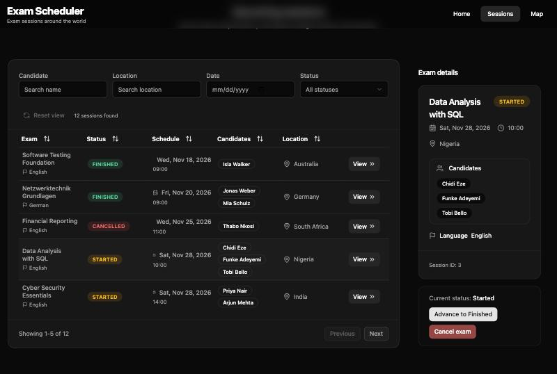

# Exam Scheduler

A dashboard for running exam sessions across countries: see what's on, where and when, who's sitting it, and move each exam from Pending to Started to Finished (or cancel it). It's built for the people who coordinate exams across several centres and need one place to watch them all.

**Try it:** https://oreva-victvs-exm-sch.vercel.app/ (demo mode, with made-up exams)



> **Status: early.** The sessions table, exam details, status changes and map work. Scheduling, live updates and a calendar are planned. See the [roadmap](ROADMAP.md).

I started this as a take-home exercise for a front-end job interview in October 2025 and have kept it as my own project since.

## What it does

- **Sessions table.** Sort and filter by candidate, location, date and status, with pagination. Built with TanStack Table.
- **Exam details.** Pick an exam to see its time, place, language and candidates, and move it to its next status or cancel it.
- **Works on phones.** The layout stacks on small screens, and picking an exam scrolls its details into view.
- **Map.** Every exam centre on a Google map.
- **Demo mode.** Without an API configured, the app runs on built-in sample data and remembers status changes in your browser, so the live demo needs no server.

All candidate names and exams are invented. The project holds no real personal data.

## Built with

| Part | Stack |
| --- | --- |
| Frontend | React 19, TypeScript, Vite, Tailwind CSS 4, Radix UI (shadcn/ui), TanStack Table, React Router |
| Backend | Laravel 12 (PHP 8.2+), Eloquent, MySQL or SQLite |
| Hosting | Vercel for the frontend |

## Run it

### Frontend only (demo mode)

```bash
cd frontend
npm install
npm run dev
```

Open http://localhost:5173. With no `VITE_API_BASE_URL` set, it uses the sample data in `frontend/src/data/sample-exams.json`.

For the map, copy `frontend/.env.example` to `frontend/.env` and add a Google Maps key:

```
VITE_GOOGLE_MAPS_KEY=your-key
```

### With the Laravel API

```bash
cd backend
composer install
cp .env.example .env
php artisan key:generate
touch database/database.sqlite   # with DB_CONNECTION=sqlite in .env
php artisan migrate --seed
php artisan serve
```

The seeder loads the same sample exams the demo uses. Then point the frontend at the API in `frontend/.env`:

```
VITE_API_BASE_URL=http://localhost:8000/api
```

### API

| Method | Path | What it does |
| --- | --- | --- |
| `GET` | `/api/exams` | Lists exams with their candidates. Filters: `status`, `country`, `language`, `date` (YYYY-MM-DD), `candidate` |
| `PUT` | `/api/exams/{id}/status` | Sets `status` (Pending, Started, Finished or Cancelled), or moves the exam to its next status if none is sent |

## How the code is laid out

| Path | What it does |
| --- | --- |
| `frontend/src/components/exam/ExamList.tsx` | The sessions table, filters, details panel and status changes |
| `frontend/src/components/exam/columns.tsx` | Table columns, sorting and filter functions |
| `frontend/src/components/exam/status.ts` | The status order, badge colours and which exams can be cancelled |
| `frontend/src/pages/Map.tsx` | The map of exam centres |
| `frontend/src/utils/examApi.ts` | Loads and updates exams, from the API or the sample data |
| `backend/app/Http/Controllers/ExamController.php` | The two API endpoints |
| `backend/database/migrations/` | The exams, candidates and exam_candidates tables |

## Licence

MIT. See [LICENSE](LICENSE).
